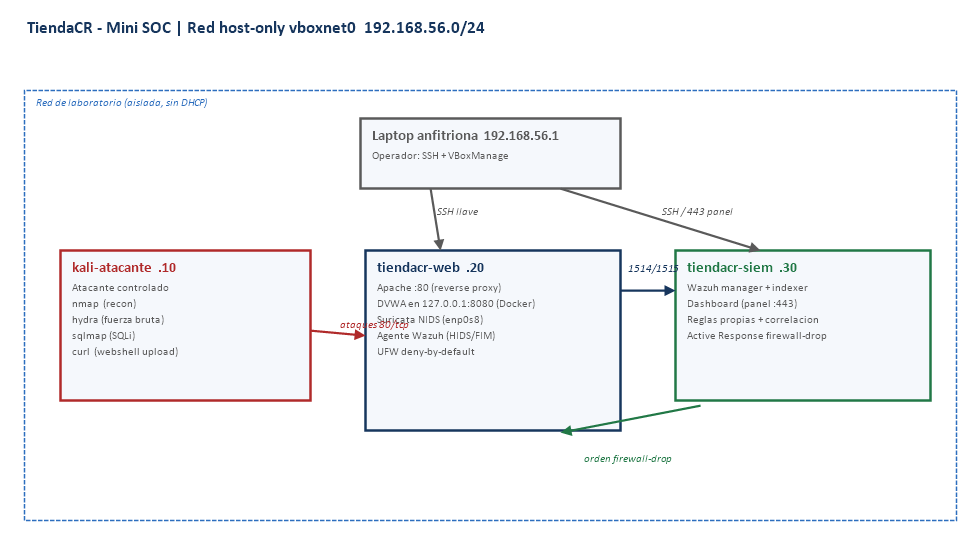

# Arquitectura

> Fuente del diagrama: [`../diagramas/arquitectura.mmd`](../diagramas/arquitectura.mmd) (Mermaid).
> Renderizar a `arquitectura.png` antes de exportar el informe.

## Componentes y direccionamiento

| VM | IP (host-only) | Rol | Servicios clave |
|----|----------------|-----|-----------------|
| `kali-atacante` | 192.168.56.10 | Atacante controlado | nmap, hydra, sqlmap |
| `tiendacr-web` | 192.168.56.20 | Objetivo + sensores | Apache (proxy :80), DVWA (Docker 127.0.0.1:8080), Suricata NIDS, agente Wazuh, UFW |
| `tiendacr-siem` | 192.168.56.30 | SIEM / SOC | Wazuh manager+indexer+dashboard, Active Response |
| Laptop anfitriona | 192.168.56.1 | Operador | SSH + VBoxManage |

La red es **host-only `vboxnet0` sin DHCP** (IPs estáticas), por lo que el laboratorio está
aislado de Internet entrante; cada VM tiene además una NIC NAT solo para descargar paquetes.

## Decisiones de diseño relevantes

1. **DVWA publicado solo en `127.0.0.1:8080`.** Docker inserta reglas iptables que **saltan UFW**;
   al escuchar únicamente en loopback, el contenedor no queda expuesto directamente a la red del
   lab. El acceso externo pasa obligatoriamente por Apache.
2. **Apache como reverse proxy en :80.** Permite registrar la **IP real** del cliente en
   `access.log` (para la correlación en Wazuh) y anteponer **ModSecurity** en la remediación sin
   tocar el contenedor.
3. **Suricata en `af-packet` sobre `enp0s8`.** Captura el tráfico **antes** de que UFW lo
   descarte, por eso detecta escaneos a puertos bloqueados (visibilidad de red real).
4. **SIEM separado del objetivo.** Si `tiendacr-web` se compromete, los logs ya viajaron al
   manager (1514/1515) y el atacante no alcanza el SIEM (UFW solo abre esos puertos al host web).

## Flujo de datos

Ataque de Kali → `tiendacr-web` (Apache/DVWA) → Suricata y agente Wazuh generan eventos →
`tiendacr-siem` correlaciona con reglas propias → si se cumple el umbral, **Active Response**
ordena `firewall-drop` de vuelta en `tiendacr-web` contra la IP atacante.

## Snapshots (hitos reproducibles)

`S0-base` → `S1-hardening` → `S2-monitoreo` → `S3-vulnerable-listo` → `S4-remediado`.
Antes de la demo se restaura `S3-vulnerable-listo`.
